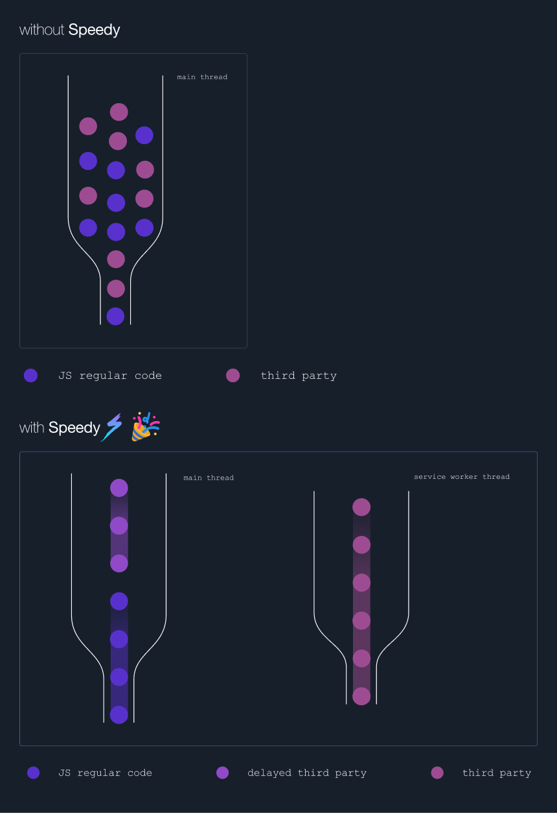
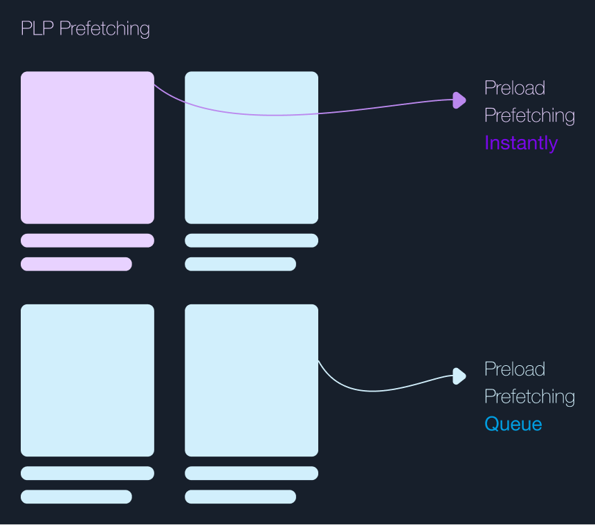
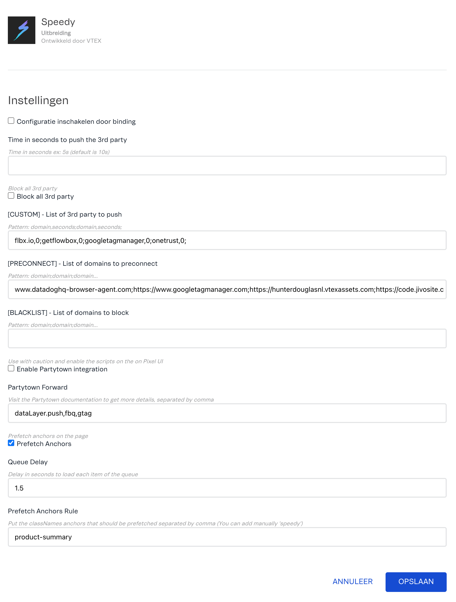

📢 Use🏃 this project, [contribute](https://github.com/vtex-apps/speedy) to it or open issues to help evolve it using [Store Discussion](https://github.com/vtex-apps/store-discussion).

<!-- prettier-ignore-start -->
<!-- markdownlint-disable -->
<!-- ALL-CONTRIBUTORS-BADGE:START - Do not remove or modify this section -->
[](#contributors-)
<!-- ALL-CONTRIBUTORS-BADGE:END -->
<!-- markdownlint-enable -->
<!-- prettier-ignore-end -->

## How it works

The **VTEX Speedy** app optimizes your store's performance by:

* Managing third-party scripts: delaying their execution or running them in web workers via Partytown integration.
* Pre-connecting and fetching the DNS reducing the time to connect to 3rd-party domains
* Prefetching pages, enhancing navigation for product listing pages (PLPs) and category views.

Moreover, **Speedy** leverages LCP (Largest Contentful Paint) and FCP (First Contentful Paint) metrics to ensure that third-party scripts do not impact page loading times.

### Speedy 3rd-party handling



## Web Vitals

### Total Blocking Time

Delaying and running scripts on web workers reduces execution on the main thread, enhancing performance:

1) Each project should be carefully analyzed and configured based on specific needs.
2) Although third-party scripts can affect loading times, their impact must be precisely calibrated.

**Speedy offers the flexibility to customize the delay timing for each third-party script by domain.**

### Interaction to Next Paint

**Speedy** enhances the INP by proactively caching pages according to predefined rules



Initially, **Speedy** is set up to prefetch and preload Product Detail Page (PDP) URLs on Product Listing Page (PLP) views. However, this functionality can be extended to any hyperlink by assigning the "**speedy**" class to `<a></a>` tags or by adjusting the settings on the configuration page.

**Prefetch:** **Speedy** optimizes loading times by prefetching the SPA URL, thus caching the target URL in advance;
**Preload:** Taking a cue from Next.js, **Speedy** enhances navigation efficiency by preloading "next URLs," thereby signaling the browser to prioritize the target URL.

Example

```html
<a class="my-custom-app-0-x-component--speedy">...</a>
```

*It will recognize whatever string includes "speedy"*

## Integrations

### Partytown

[Partytown](https://github.com/BuilderIO/partytown) library is built into **Speedy** and that has been optimized to function flawlessly and to fully utilize its capability to execute scripts in service workers without any issues.

**To enable the integration you should check the flag in the App Management.**

### Pixel Server & Pixel Server UI

These enhancements boost **Speedy's** flexibility by allowing modifications such as configuring pixel apps to "text/partytown" for processing in web workers. This setup enables the orderly organization and rearrangement of pixel apps as needed. 

## Settings

### TTFB, LCP & FCP improvement

While **Speedy** does not directly impact these metrics, we strongly recommend taking certain steps to enhance its performance:

You should change the overwrite cache settings: 

1. Make sure the app are installed correctly: 
* ```vtex-rewriter: >= 1.62.0``` 
* ```vtex.render-server:  >= 8.171.0```

```ssh
# List the apps or deps

vtex deps ls | grep render-server
vtex deps ls | grep rewriter

# Installing

vtex install vtex-rewriter@1.62.0
vtex install vtex.render-server@8.171.0

```
2. Enable the flag overwrite cache control settings on these apps and set the values like the image below:

**vtex.render-server**

**vtex-rewriter**


**Example:**
* **Max-Age**: 300 (5 minutes) - VTEX default - we don't recommend modifying it;
* **Stale Revalidate overwrite**: 86400 (24 hours) - this metric is pretty subjective once you MUST calibrate it according to your needs;

By implementing these modifications, we will enhance the cache CDN by maintaining a version of the content for 24 hours. During this period, the `Max-Age` header will specify that the content can be served from the cache without revalidation for up to 24 hours. Concurrently, the `Stale-While-Revalidate` header will allow the CDN to serve stale content while it asynchronously fetches new content from the source (VTEX). This approach ensures that users receive content quickly while the most recent updates are being retrieved and stored.

❗**Make sure the 86400 seconds works, otherwise, lower values can be applicable**

### Potential Side Effects

❗ Using a long stale-cache if revalidate can bring some side effects like:
  - Delaying on price update (PLP and PDP)
  - Google Shopping mismatch prices

## Installing Speedy

1. Access the **Apps** section in your account's admin page and look for the **Speedy** box;
2. Then, click on the **Install** button;
3. You'll see a warning message about needing to enter the necessary configurations. Scroll down and fill the additional information in the settings area
4. Click on **Save**.


**VTEX CLI**

```vtex install vtex.speedy@0.x```

## Setting up

You must need to set up speed to ensure that everything is running smoothly
After installing **Speedy**, follow this steps:

### 1) Partytown scripts (TBT)

1. Identify the 3rd-party scripts that are running into your site, we strongly recommend to use [Webpage Test](https://www.webpagetest.org/);
2. Once you get it, open the Pixel Render UI by accessing this URL: **/admin/pixel-server-ui/**
3. ❗❗❗Select **CAREFULLY** the Pixel Apps you want to run through *Speedy/Partytown*❗❗❗
4. Move the speedy to the top and DON'T check it as partytown


4. Click on Save Button and test it

### 2) Speedy App Setup

Currently **Speedy** doesn't have a friendly UI to setup the config, the only way is to access the Settings on App Management:

```Access Admin > My Apps (App Management) > Type Speedy on the search```

**You need the Admin Access to save these settings**



### Time in seconds to push the 3rd-party
By the default, **Speedy** **delays 5s** when it identifies a 3rd script that could affect loading, here you can modify this option;

### List of 3rd-party to push

In this field you can provide a custom list of the domains that you want to push, or adding **0** the **Speedy** will only wait the LCP and FCP to run them.

***Pattern: domain,time-in-seconds;***
```
googletagmanager,0;onetrust.com,0;3rdparty.com,10;
```

We strongly recommend to let Google Tag Manager and Onetrust(or similar) with 0 

### [PRECONNECT] List of domains to preconnect
List of 3rd-party domains to preconnect, by adding the domains here, **Speedy** will add the `<link ref="preconnect">` and `<link ref="dns-prefetch">` in order to speed up the loading time of all requested connections.

***Pattern: domain;domain;...***
```
googletagmanager;onetrust.com;3rdparty2.com;
```
### Enable Partytown Integration
Enables the partytown integration by providing the partytown global config

### Partytown Forward
The list of forward events that partytown handles, see [the documentation](https://partytown.builder.io/forwarding-events) for more details.

**Use comma to separate the values:** value1,value2...

### [BLACKLIST] List of domains to block
Speedy provides a feature to block the domains for testing purpose.

***Pattern: domain;domain;...***
```
googletagmanager;onetrust.com;3rdparty2.com;
```

### Prefetch Anchors

This flag enables or disables the **Prefetching Feature**.

### Queue Delay

This configuration impacts on the **Prefetching Feature**. The queue delay is the time in seconds for each element will take to process (prefetch and preload).

### Prefetch Rule

That's the rule that will check if the anchors should be cached, by default it's product-summary for the PLPs.

## Debugging

Passing `{{domain}}?speedDebug=true` or accessing the site through `{{account}}.myvtex.com` the **Speedy** Debug will be enabled and you can check the logs in the `Console`.

## Contributors ✨

<!-- ALL-CONTRIBUTORS-LIST:START - Do not remove or modify this section -->
<!-- prettier-ignore-start -->
<!-- markdownlint-disable -->
<!-- markdownlint-enable -->
<!-- prettier-ignore-end -->
<!-- ALL-CONTRIBUTORS-LIST:END -->

This project follows the [all-contributors](https://github.com/all-contributors/all-contributors) specification. Contributions of any kind are welcome!

<!-- DOCS-IGNORE:end -->
